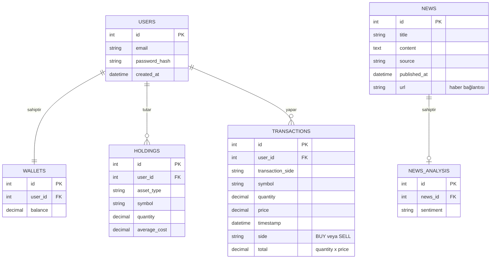

# Veritabanı Tasarımı (ERD)

## Tasarım kararları
- **Çoklu Varlık Desteği:** Kullanıcının tek bir TL cüzdanı (`WALLETS`) bulunur; bakiye negatif olamaz. Hisse senedi, kripto ve altın gibi varlıklar `HOLDINGS` tablosunda `asset_type` ayrımıyla tutulur.
- **Hassas Veri Tipi (Decimal):** Bakiye, varlık miktarları (`quantity`) ve birim fiyatlar (`price`, `average_cost`) finansal hesaplama hatalarını önlemek adına tam sayı yerine `decimal` veri tipinde tanımlanmıştır.
- **Duygu Analizi (Sentiment):** Haber duygu analizi sonuçları (`NEWS_ANALYSIS`), haber metninden bağımsız olarak bire bir ilişkili ayrı bir tabloda `sentiment` alanıyla saklanır.
- **Veri Güvenliği:** Kullanıcı parolaları veritabanında asla düz metin (plain text) olarak saklanmaz, `password_hash` ile hash'lenerek tutulur.
- **İşlem Geçmişinin Değişmezliği:** `TRANSACTIONS` tablosu, varlık fiyatı veya cüzdan bakiyesi değişse bile geçmiş işlemlerin değişmezliğini (immutability) korumak adına işlem anındaki fiyatı (`price`), miktarı (`quantity`), işlem yönünü (`side`) ve toplam işlem tutarını (`total`) kaydeder. `total`, `quantity × price` olarak hesaplanır.
- **OpenAPI Uyumluluğu:** Tüm alan isimleri ve veri tipleri projenin `docs/openapi.yaml` spesifikasyonu ile büyük ölçüde uyumludur (`TRANSACTIONS` tablosundaki `side` alanı OpenAPI spesifikasyonuna göre güncellenmiştir).
- **Haber Kaynağı:** `NEWS` tablosundaki `url` alanı, haberin orijinal bağlantısını saklayarak kullanıcının haberin kaynağına erişmesini sağlar.
